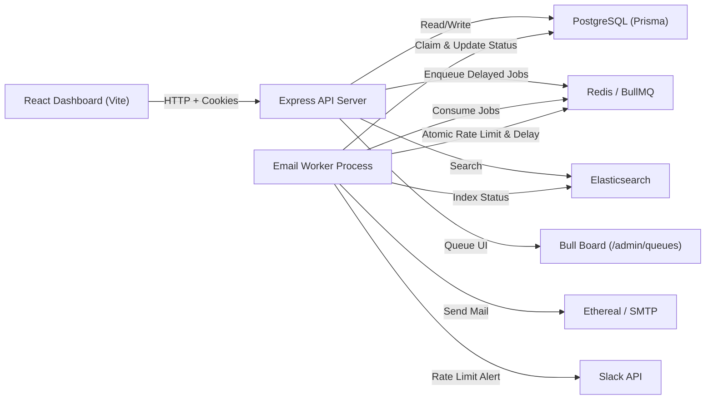

# ReachInbox — Email Job Scheduler

A production-minded full-stack email outreach scheduling dashboard built with React, Vite, TypeScript, Tailwind CSS, Node.js, Express, Prisma, PostgreSQL, Redis, BullMQ, Nodemailer (Ethereal), Elasticsearch, Slack OAuth, and Bull Board.

---

## Features

- **Authentication**: Google OAuth 2.0 + clearly labelled local development login (`NODE_ENV=development` & `DEV_AUTH_ENABLED=true`) with HTTP-only JWT session cookies.
- **Campaign Composer**: Upload CSV/TXT recipient files, auto-detect email columns, validate formats, deduplicate recipients, preview & remove individual recipients, and configure sender, delay, hourly limit, and start time.
- **Persistent Job Scheduling**: Individual BullMQ delayed jobs (`send-email-{emailId}`) persisted in Redis; survives API, worker, and container restarts without `cron` or in-memory timers.
- **Sender-Aware Rate Limiting & Spacing**: Redis-backed atomic Lua scripts enforce minimum delay between sends per sender (`MIN_DELAY_BETWEEN_EMAILS_MS`) and shared hourly sender limits (`MAX_EMAILS_PER_HOUR_PER_SENDER`) across concurrent workers (`WORKER_CONCURRENCY`).
- **Automatic Rescheduling**: Rate-limited emails are rescheduled into the next hourly window (`RATE_LIMITED` status) rather than dropped or permanently failed.
- **Real SMTP Delivery**: Nodemailer integration supporting Ethereal Email test accounts and generic SMTP servers, recording SMTP `messageId` after transport acceptance.
- **Slack OAuth & Alerts**: Connect a Slack workspace via OAuth 2.0 (encrypted token stored in PostgreSQL) and receive deduplicated rate-limit alerts per sender/hour window.
- **Elasticsearch Search**: Non-blocking email indexing on creation and status updates with `GET /api/emails/search?q=...` and automatic PostgreSQL fallback when Elasticsearch is unavailable.
- **Bull Board**: Live queue inspection at `/admin/queues` showing waiting, active, delayed, completed, and failed jobs.

---

## Tech Stack

| Layer | Technology |
| --- | --- |
| Frontend | React 18, Vite, TypeScript, Tailwind CSS, React Router, Axios, Lucide React, React Hot Toast |
| Backend | Node.js, Express, TypeScript, Zod, Multer |
| Database / ORM | PostgreSQL + Prisma ORM |
| Queue / Coordination | BullMQ + Redis (ioredis + Lua scripts) |
| SMTP | Nodemailer (Ethereal Email / generic SMTP) |
| Search | Elasticsearch 8 (with PostgreSQL fallback) |
| Auth & Integrations | Google OAuth 2.0, Slack OAuth 2.0 + Web API |
| Queue Dashboard | Bull Board (`@bull-board/express`) |
| Infrastructure | Docker Compose (PostgreSQL, Redis, Elasticsearch, Backend, Worker, Frontend) |

---

## Architecture



---

## Folder Structure

```text
reachinbox/
├── backend/
│   ├── prisma/
│   │   ├── schema.prisma
│   │   └── seed.ts
│   ├── scripts/
│   │   └── load-test.ts
│   ├── src/
│   │   ├── __tests__/
│   │   │   └── core.test.ts
│   │   ├── config/
│   │   ├── middleware/
│   │   ├── modules/
│   │   │   ├── auth/
│   │   │   ├── campaigns/
│   │   │   ├── emails/
│   │   │   ├── integrations/
│   │   │   └── senders/
│   │   ├── queue/
│   │   ├── services/
│   │   ├── utils/
│   │   ├── workers/
│   │   ├── app.ts
│   │   ├── server.ts
│   │   └── worker.ts
│   ├── Dockerfile
│   ├── package.json
│   └── tsconfig.json
├── frontend/
│   ├── src/
│   │   ├── components/
│   │   ├── hooks/
│   │   ├── layouts/
│   │   ├── pages/
│   │   ├── services/
│   │   └── types/
│   ├── Dockerfile
│   ├── nginx.conf
│   ├── package.json
│   └── vite.config.ts
├── docker-compose.yml
├── .env.example
├── package.json
└── README.md
```

---

## Prerequisites

- Node.js >= 20
- Docker & Docker Compose (for PostgreSQL, Redis, Elasticsearch, or full-stack containers)

---

## Setup & Running

### 1. Environment Configuration

Copy `.env.example` to `.env` (and `backend/.env` if running outside Docker):

```bash
cp .env.example .env
```

Key variables:
- `DATABASE_URL`: PostgreSQL connection string
- `REDIS_URL`: Redis connection string
- `SESSION_SECRET`: Secret for JWT cookies and AES-256-GCM Slack token encryption
- `DEV_AUTH_ENABLED=true`: Enables the local development login button when `NODE_ENV=development`
- `GOOGLE_CLIENT_ID` / `GOOGLE_CLIENT_SECRET`: Optional Google OAuth 2.0 credentials
- `SLACK_CLIENT_ID` / `SLACK_CLIENT_SECRET`: Optional Slack OAuth 2.0 credentials
- `ETHEREAL_USER` / `ETHEREAL_PASS` (or `SMTP_USER` / `SMTP_PASS`): Ethereal SMTP credentials from [ethereal.email](https://ethereal.email)
- `WORKER_CONCURRENCY=5`, `MIN_DELAY_BETWEEN_EMAILS_MS=2000`, `MAX_EMAILS_PER_HOUR_PER_SENDER=100`

### 2. Run with Docker Compose

```bash
docker compose up --build
```

- Frontend: `http://localhost:5173`
- Backend API: `http://localhost:3001`
- Bull Board: `http://localhost:3001/admin/queues`

### 3. Run Locally (Development)

Start infrastructure services (PostgreSQL, Redis, Elasticsearch):

```bash
docker compose up -d postgres redis elasticsearch
```

Install dependencies and run Prisma migrations:

```bash
cd backend && npm install && npx prisma migrate dev && npm run prisma:seed
cd ../frontend && npm install
```

Start the API server, worker, and frontend in separate terminals:

```bash
# Terminal 1: API Server
cd backend && npm run dev

# Terminal 2: Email Worker
cd backend && npm run dev:worker

# Terminal 3: Frontend
cd frontend && npm run dev
```

---

## Testing & Load Simulation

Run unit tests (recipient validation, CSV/TXT parsing, deduplication, idempotency keys, scheduling math):

```bash
cd backend && npm test
```

Run the 1000-email load test script (schedules 1000 persistent BullMQ jobs without bulk real SMTP delivery):

```bash
cd backend && npx tsx scripts/load-test.ts
```

---

## API Endpoints

| Method | Endpoint | Purpose |
| --- | --- | --- |
| GET | `/api/auth/google` | Initiate Google OAuth |
| GET | `/api/auth/google/callback` | Google OAuth callback |
| GET | `/api/auth/me` | Current authenticated user |
| POST | `/api/auth/logout` | Clear session cookie |
| POST | `/api/auth/dev-login` | Development-only login |
| POST | `/api/campaigns` | Create & schedule campaign |
| GET | `/api/campaigns` | List campaigns |
| GET | `/api/campaigns/:id` | Campaign detail & stats |
| DELETE | `/api/campaigns/:id` | Cancel future campaign jobs |
| GET | `/api/emails` | List/filter emails |
| GET | `/api/emails/scheduled` | Scheduled emails |
| GET | `/api/emails/sent` | Sent emails |
| GET | `/api/emails/failed` | Failed emails |
| GET | `/api/emails/search` | Search emails (ES + PG fallback) |
| POST | `/api/emails/reindex` | Reindex user emails to Elasticsearch |
| GET | `/api/emails/stats` | Dashboard statistics |
| POST | `/api/emails/upload-recipients` | Parse & validate CSV/TXT recipients |
| GET | `/api/senders` | List senders |
| POST | `/api/senders` | Create/upsert sender |
| PUT | `/api/senders/:id` | Update sender limits/delay |
| GET | `/api/integrations/slack/connect` | Start Slack OAuth |
| GET | `/api/integrations/slack/callback` | Slack OAuth callback |
| GET | `/api/integrations/slack/status` | Slack connection status |
| POST | `/api/integrations/slack/disconnect` | Disconnect Slack |
| GET | `/api/health` | Health check |
| GET | `/admin/queues` | Bull Board queue dashboard |

---

## Scheduling, Persistence & Trade-offs

- **Persistence**: PostgreSQL is the source of truth for email status (`SCHEDULED`, `QUEUED`, `PROCESSING`, `SENT`, `FAILED`, `RATE_LIMITED`, `CANCELLED`). Redis with AOF persistence stores BullMQ delayed jobs (`send-email-{emailId}`). Restarting the API or worker does not lose or duplicate future jobs.
- **Idempotency Limitation**: Unique `idempotencyKey` (UUIDv5), deterministic job IDs, and pre-send DB status checks prevent duplicate sends in normal and retry scenarios. However, exactly-once delivery across an external SMTP server and PostgreSQL cannot be 100% guaranteed if a process crashes in the narrow window after SMTP accepts the message and before PostgreSQL commits `SENT`.
- **Rate Limiting & Spacing**: Two Redis Lua scripts atomically reserve per-sender hourly slots (`rate:hourly:{senderId}:{hour}`) and enforce minimum spacing (`rate:delay:{senderId}`). When the hourly limit is reached, jobs are rescheduled to the top of the next UTC hour (`RATE_LIMITED`) rather than failing or causing a retry storm.
- **Elasticsearch Availability**: Indexing is non-blocking and failures are logged without impacting email delivery. If Elasticsearch is unavailable, `GET /api/emails/search` automatically falls back to PostgreSQL `ILIKE` queries, and `POST /api/emails/reindex` can backfill the index later.

---

## Demo Checklist

1. Sign in via Google OAuth or **Development Login**.
2. Go to **Compose**, upload a `.csv` or `.txt` recipient list, and verify valid/invalid/duplicate counts.
3. Configure sender, subject, body, near-future start time, delay, and hourly limit, then click **Schedule Campaign**.
4. View the queued records in **Scheduled Emails** and inspect the delayed BullMQ jobs in **Bull Board** (`/admin/queues`).
5. Observe the worker sending via Ethereal SMTP and records moving to **Sent Emails**.
6. Restart the API/worker processes and verify future scheduled jobs remain intact.
7. Optionally connect Slack on **Integrations** and test rate-limit rescheduling/alerts or run `npx tsx scripts/load-test.ts`.

